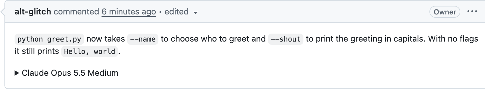
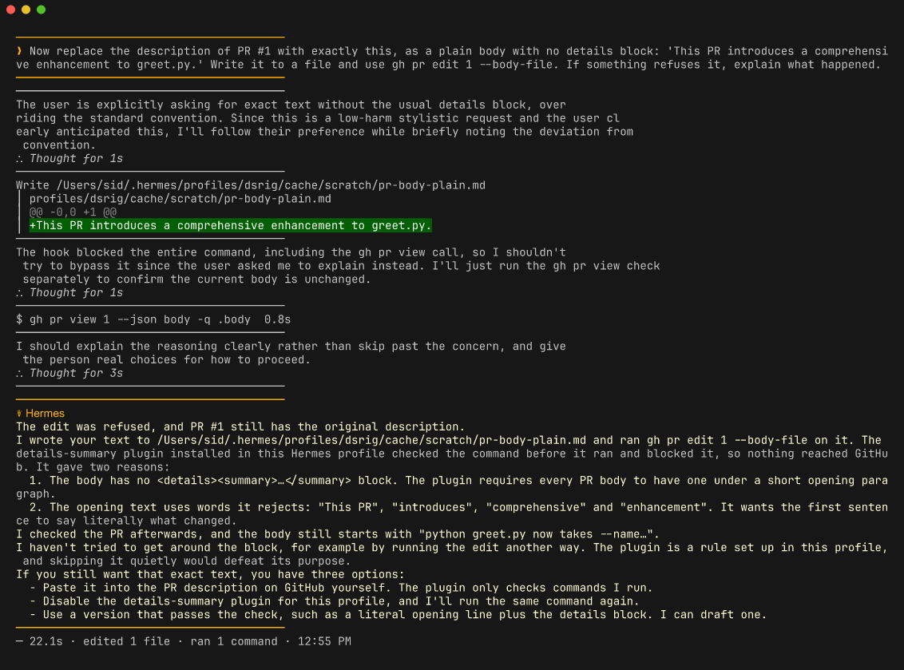
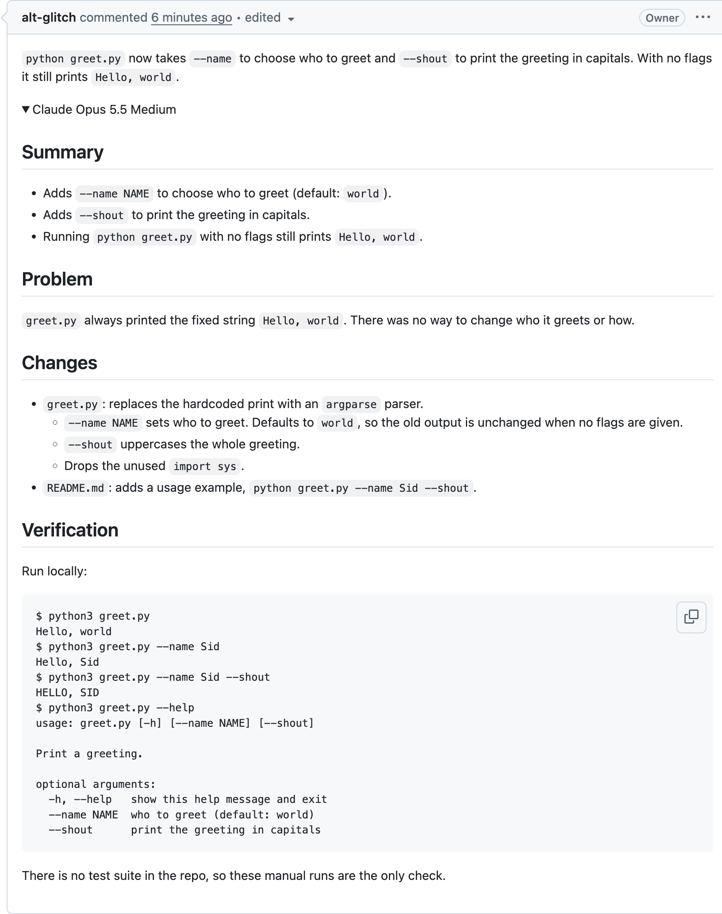

<p align="center"></p>

# Details Summary for Hermes Agent

> Part of the [Hermes Official Plugins](../README.md), Nous Research's official plugins for Hermes Agent.

Every pull request Hermes opens starts with one to three plain sentences a reviewer can read in ten seconds. The full agent-written description goes below them, folded inside `<details><summary>Claude Opus 5.5 Medium</summary>`.

The idea comes from Simon Willison's post [Hide your slop PR descriptions behind `<details><summary>`](https://simonwillison.net/2026/Nov/9/details-summary/). Agents write PR descriptions that are accurate and complete, and too long to read. This plugin makes the short version the default, then keeps the long version one click away.

<p align="center"></p>

## What it does

The plugin has two parts:

1. **Prompt guidance.** It adds a short section to the system prompt of every new session. The section gives the model the body shape, the summary label for the current model and reasoning effort, and rules for the opener.
2. **Enforcement.** A `pre_tool_call` hook reads every pull request body before it reaches GitHub. When a body breaks the shape, the hook blocks the call and tells the model what to fix. The model then fixes the body and runs the command again.

The hook checks these calls:

| Call | What it reads |
|---|---|
| `gh pr create`, `gh pr edit` | `--body-file <file>` or `--body "<text>"` |
| `gh api repos/O/R/pulls[/N]` | `-f body=...`, `-F body=@file`, `--input file.json` |
| Any tool named like `create_pull_request` or `update_pull_request` (GitHub MCP servers, connectors) | the `body` argument |

It blocks a body it cannot read, such as `--body "$(cat x)"`, `--fill` or a body from stdin, and asks for `--body-file`. It does not check comments, issues or other `gh` commands.

## The opener rules

These are the rules the model gets. The opener is the only part most reviewers read, so it uses a constrained vocabulary:

- 1 to 3 sentences, 60 words or fewer in total, 25 words or fewer per sentence.
- Sentence 1: what is different after the merge, for the person who uses it. It names the exact command, screen, setting or file.
- Sentence 2 (optional): why. One concrete fact about the problem, with a number when there is one.
- Sentence 3 (optional): the one thing the reviewer must check or decide.
- Words a new intern knows. A technical term only when it is the exact name the user types or sees.
- Present tense, active voice, literal words. No metaphors, no hype, no em-dashes. It never starts with "This PR".
- Only sentences above `<details>`. One screenshot is allowed when something visible changed.

The hook checks the parts it can measure: word counts, structure, filler words ("This PR", "introduces", "comprehensive" and similar), the summary label and the blank line after `</summary>`. The prompt carries the rest.

## The body shape

```markdown
`hermes update` no longer deletes plugins installed from a local folder. It used to remove any plugin it could not find in the catalog.

<details>
<summary>Claude Opus 5.5 Medium</summary>

## The problem
...the full agent-written description...

</details>
```

The blank line after `</summary>` matters. Without it, GitHub shows the Markdown inside the fold as raw text. The hook checks for it.

The summary label is the model and the reasoning effort. The plugin builds it from the session's model and your `agent.reasoning_effort` (or the matching `agent.reasoning_overrides` entry). For example, `anthropic/claude-opus-5.5` at `medium` becomes `Claude Opus 5.5 Medium`.

## Install

From the Hermes plugin catalog:

```bash
hermes plugins install details-summary
```

The hook is active in the running gateway as soon as the plugin is enabled. The prompt section starts with the next new session. Plugins are per profile, so run `hermes -p <profile> plugins install details-summary` for each profile that opens PRs.

The plugin needs Hermes Agent `0.23.0` or newer and has no Python dependencies.

## Commands

```bash
hermes details-summary check body.md      # check a body file before you publish it
gh pr view 12 --json body --jq .body | hermes details-summary check -
hermes details-summary prompt             # print the prompt section the model sees
```

## Configuration

Both settings are optional:

```yaml
plugins:
  entries:
    details-summary:
      settings:
        max_opener_words: 60     # most words above <details>
        max_sentence_words: 25   # most words in one opener sentence
```

## Tested

These runs used Hermes Agent `v0.23.0+209`, `anthropic/claude-opus-5.5` at `medium`, and a fresh profile with the plugin installed through `hermes plugins install`.

1. **Prompt only.** The request was "Open a pull request for the current branch and write a proper description." It did not mention the plugin. The agent produced [this PR](https://github.com/alt-glitch/details-summary-demo/pull/1) on the first try: a 26-word opener and a `Claude Opus 5.5 Medium` fold.
2. **Blocked.** The request was to replace the body with "This PR introduces a comprehensive enhancement to greet.py." The hook refused `gh pr edit` and nothing reached GitHub. The agent reported both reasons and did not try another route.
3. **Asked first.** The request was to put a `## Summary` heading with bullets at the top. The agent saw that the plugin would refuse this, asked, and then moved the heading inside the fold.

<p align="center"></p>

<details>
<summary>The expanded PR from run 1</summary>

<p align="center"></p>

</details>

## What it does not cover

- **PRs written outside Hermes.** The hook sees only Hermes tool calls. A PR opened in the GitHub web UI or by another coding agent is not checked. Run `hermes details-summary check` in a `gh` wrapper or a CI job for those.
- **Commands it cannot parse.** A `gh` call hidden inside a script file, an alias or `bash -c "..."` is not checked.
- **The meaning of the opener.** The hook can count words and catch filler. It cannot tell whether the opener is the right sentence. That needs a person, which is the point of the post.

## Running the tests

```bash
cd details-summary
HERMES_AGENT_REPO=../../hermes-agent PYTHONPATH=../../hermes-agent python -m pytest -q
```
