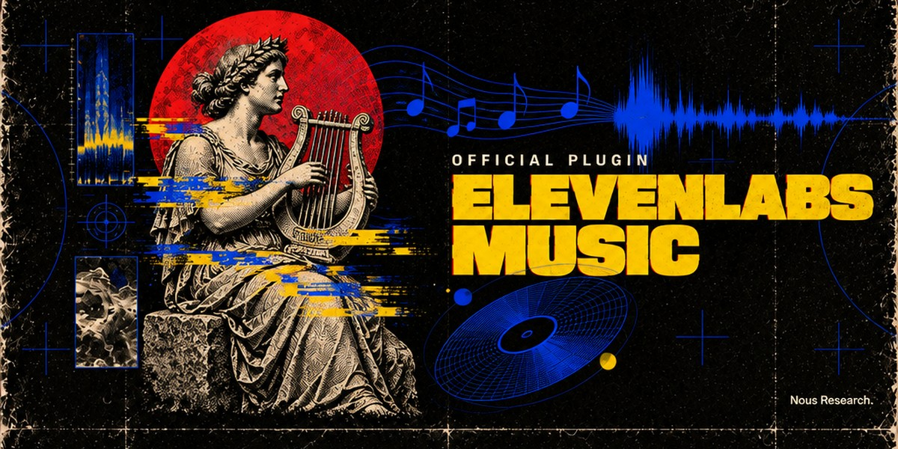

<p align="center"></p>

# ElevenLabs Music for Hermes Agent

> Part of the [Hermes Official Plugins](../README.md), Nous Research's official plugins for Hermes Agent.

Official [Hermes Agent](https://github.com/NousResearch/hermes-agent) plugin for the
[ElevenLabs Music API](https://elevenlabs.io/docs/overview/capabilities/music). Ask for "a 40 second
upbeat synthwave intro for my podcast", "a sad indie folk song about a lighthouse, female vocals", or
paste your own lyrics, and Hermes writes, generates and sends you the track. It can then change one
section, add an outro, loop it, make the vocals or drums a separate file, or score a video.

| Tool | What it does | Billed |
|---|---|---|
| `elevenlabs_music_compose` | A song or instrumental from a prompt, 3 seconds to 10 minutes, vocals in many languages | by length |
| `elevenlabs_music_draft_plan` | ElevenLabs writes a composition plan from a prompt: sections, lyrics, styles, durations | free |
| `elevenlabs_music_compose_plan` | Generate from a plan: exact lyrics and structure, and edits of earlier songs (keep some parts, regenerate others, extend, loop, "sounds like this") | by length |
| `elevenlabs_music_upload` | Store your own song at ElevenLabs so the plan tool can edit, extend or sample it | like a generation |
| `elevenlabs_music_stems` | Split a track or any audio file into 2 stems (vocals, accompaniment) or 6 (vocals, drums, bass, guitar, piano, other) | by length |
| `elevenlabs_music_from_video` | Background music timed to 1-10 videos, optionally with sound effects, music and effects as separate files if you like | by length |
| `elevenlabs_music_finetunes` | The Music finetunes your account can use (yours, your workspace's, ElevenLabs-curated styles) | free |
| `elevenlabs_music_job` | Check on or wait for a generation still running in the background | free |

Each tool hands the agent `MEDIA:` lines for the files it made; the agent puts them in its reply and the
files arrive as attachments on Telegram, Discord, Slack and the other messaging platforms. In Hermes
Desktop the same line becomes a music card (below). In the terminal you get the file path.

The plugin also ships the `elevenlabs-music` skill: how to write music prompts (from ElevenLabs' own
prompting guide), when to draft a plan, how to build the chunk lists that edit, extend or loop a song,
and how to deliver on each surface.

## Install

```bash
hermes plugins install elevenlabs-music
```

Or straight from this repo: `hermes plugins install NousResearch/hermes-official-plugins#elevenlabs-music`.

The installer asks for your ElevenLabs API key if `ELEVENLABS_API_KEY` is not set yet (create one under
**Profile → API keys** at <https://elevenlabs.io/app/settings/api-keys>). It is the same key Hermes's
ElevenLabs voice and the ElevenLabs Sound Effects plugin use. The Music API needs a paid ElevenLabs plan,
and a restricted key needs the **Music** permission. The tools appear to the agent only once the key is
set. Plugins are installed per profile: `hermes -p <profile> plugins install elevenlabs-music` for another
profile. The only Python dependency is `httpx`, which Hermes already ships.

## Long songs and chat apps

A generation runs in the background and the tool waits for it: up to about five minutes in the terminal,
Hermes Desktop and other local apps, and only `chat_app_wait_seconds` (20 by default) in chat apps. Short
clips come back within that wait (a 10 second clip took about 4 seconds in testing). When a longer song
is still generating, the agent tells you it started, sets a background timer, and sends the song into the
chat when it is done, so the chat is never silent for minutes. Asking "is it done?" checks right away. A
generation that a Hermes restart interrupts is reported as interrupted; ElevenLabs may still have billed
it, so the agent asks before trying again.

## Settings

In Hermes Desktop: **Capabilities → Plugins**, then the gear icon on the plugin (⌘K → **ElevenLabs Music:
settings** opens it). Everywhere else, with `hermes config set`:

| Setting | Default | What it does |
|---|---|---|
| `api_key` | (unset) | Your ElevenLabs API key, stored in `.env` as `ELEVENLABS_API_KEY`: `hermes config set ELEVENLABS_API_KEY <key>` |
| `music_model` | `music_v2_5` | `music_v2_5`, `music_v2` or `music_v1`: `hermes config set plugins.entries.elevenlabs-music.settings.music_model music_v2`. Plans, edits and audio references need v2 or v2.5 |
| `output_format` | `mp3_44100_128` | `mp3_44100_128`, `mp3_44100_192`, `mp3_48000_192`, `mp3_48000_320`, `opus_48000_128`, `opus_48000_192`: `hermes config set plugins.entries.elevenlabs-music.settings.output_format mp3_48000_320`. ElevenLabs documents 192 kbps MP3 for its Creator plan and above. The Music API has no WAV container; the Desktop card's Download menu converts to WAV or FLAC with ffmpeg |
| `store_for_editing` | `true` | Asks ElevenLabs to keep each song so later requests can edit, extend or sample it (no extra cost): `hermes config set plugins.entries.elevenlabs-music.settings.store_for_editing false` |
| `chat_app_wait_seconds` | `20` | How long a request waits in a chat app before the agent replies "started" (0-240): `hermes config set plugins.entries.elevenlabs-music.settings.chat_app_wait_seconds 45` |
| `api_base_url` | `https://api.elevenlabs.io` | Change only for an ElevenLabs data-residency endpoint, e.g. `https://api.eu.residency.elevenlabs.io` |

Every argument is checked before anything is sent: prompts up to 4,100 characters, songs 3 seconds to 10
minutes, plans of 1-30 chunks of 3-120 seconds each, 30 lyric lines of 200 characters per chunk, 50
styles per list, audio references up to 30 seconds. A setting outside its choices (a hand-edited
`config.yaml`) is refused rather than billed.

## Where files go

Each track is saved to `<HERMES_HOME>/cache/generated/audio/` as `music_<title>_<timestamp>_<id>.<ext>`
(stems as `stem_<stem>-<title>_…`, video scores as `score_…`) and never overwrites an earlier one. Ask
the agent to copy one into your project if you want it somewhere else. The Desktop card and library serve
a file only while it has a single link: after a backup tool hard-links your Hermes folder (rsnapshot,
`cp -al`), those tracks play in Desktop's built-in player instead.

Each file also gets one line in `<HERMES_HOME>/plugin-data/<plugin namespace>/tracks.jsonl` (the
plugin's own data folder, per profile): the track id, kind, title, prompt, genres, model, the length
asked for and the real length, format, file name, ElevenLabs' song id and the chat it came from. A
song's lyrics timing and composition plan go in `details/<id>.json` beside it, and background jobs in
`jobs/` (kept 7 days). The Desktop library reads these. Nothing in them leaves your machine.

## What is sent to ElevenLabs

Only the prompt or plan and the arguments of each call, plus, for the upload, stems and video tools, the
file you name, go to `api.elevenlabs.io` (or the endpoint you set). With `store_for_editing` on,
ElevenLabs keeps each generated song on its side so it can be edited later. Uploads are screened by
ElevenLabs for copyright.

## Hermes Desktop

The Desktop half is opt-in, also after `hermes plugins install` from the CLI (which turns on only the
agent half): open **Capabilities → Plugins**, switch to the list view, and turn on **Desktop: ElevenLabs
Music** on the plugin's row. Without it Desktop still plays every track in its built-in audio player.

**Music card.** Hermes Desktop works out which tool produced a `MEDIA:` file and, when it was one of this
plugin's tools and the Desktop half is on, lets the plugin draw it as a music card instead of the built-in
player. That needs a Hermes Desktop with tool-media renderers (on `main` since commit `567569267a`); on
older Desktops the same line plays in the built-in player. The card shows the title, ElevenLabs'
description, genres, length, model and format; a waveform you can click to seek; Play/Pause and Loop; the
words being sung, highlighted as the song plays; the full **Lyrics**; **Download** (the original, or MP3 /
WAV / OGG / FLAC converted by ffmpeg on the machine Hermes runs on; WAV for songs up to about 5 minutes, FLAC up to about 7); and **Reveal** in your file manager.
**Next** offers 3 variations, an instrumental version, the other model, **Extend by 30 s**, **Redo** any
section (it puts a started message in the composer for you to say what to change), and **Split into
stems**. Each row says how much music it bills and sends a chat message naming the tool and its
arguments; nothing is billed until the agent runs the tool. Stems and video scores get the same card.

**Music library.** ⌘K → **ElevenLabs: open music library** opens a tab listing every track the tools made
in the active profile, with per-kind counts, total minutes and sizes, a filter for songs, stems and video
scores, and a search over titles, prompts and genres. Each row plays, downloads, reveals, **Reuse prompt**
(into the composer) and **Open chat** (the conversation that made it). It reloads when a track is made,
when you switch profile or connection, and when you save the plugin's settings; it never polls.

**Remote Hermes.** The Desktop half runs in the Desktop app, so install the plugin on the Hermes machine
(agent half) and into the Desktop you use: **Capabilities → Plugins → Install from Git** with
`NousResearch/hermes-official-plugins/elevenlabs-music` and **Desktop UI** checked, then turn on
**Desktop: ElevenLabs Music**. Playback and downloads stream through Hermes, so they work against a
remote machine too; Reveal tells you where the file is instead.

No account-wide UI (credit balance, usage) by design: Hermes's ElevenLabs voice and the ElevenLabs Sound
Effects plugin use the same account.

## Development

```bash
# plugin suite against a hermes-agent checkout
HERMES_AGENT_REPO=~/hermes-agent PYTHONPATH=~/hermes-agent python -m pytest -q
# Desktop half: pure-helper tests, typecheck, bundle (desktop/plugin.js is committed)
npm install && npm test && npx tsc --noEmit && npm run build
```

## License

MIT
