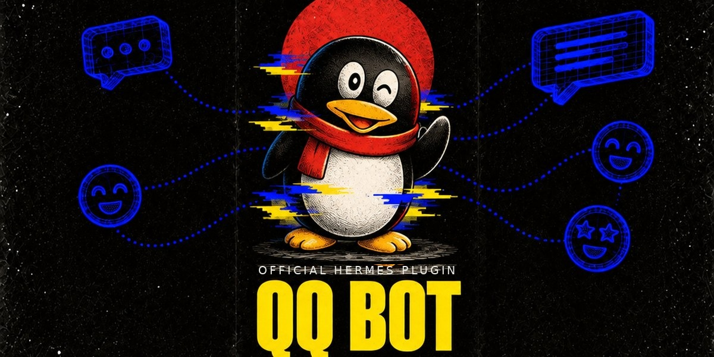

<p align="center"></p>

# QQ Bot for Hermes Agent

> Part of the [Hermes Official Plugins](../README.md), Nous Research's official plugins for Hermes Agent. Formerly built into [Hermes Agent](https://github.com/NousResearch/hermes-agent) core (`plugins/platforms/qqbot`); this directory carries its full history.

Connect Hermes to QQ through the **official QQ Bot API (v2)**: private (C2C) chats, group @-mentions and guild
channels over QQ's bot WebSocket gateway, replies (text, markdown and native media) over the REST API, voice
transcription, scan-to-configure setup and cron delivery to a home channel.

Everything an existing setup relies on is unchanged: platform name `qqbot`, every `QQ_*` / `QQBOT_*` env var
(including the legacy `QQ_HOME_CHANNEL`), the `platforms.qqbot` config keys and `QQBOT_HOME_CHANNEL`. Hermes
installs this plugin automatically for profiles that used the built-in QQ Bot platform.

This plugin is **installed and enabled by default on every Hermes home** (catalog `default: true`). It does
nothing until you configure it: with no `QQ_APP_ID` / `QQ_CLIENT_SECRET` the gateway never starts the adapter.

## Install

```bash
hermes plugins install qqbot
```

Needs a Hermes release in which QQ Bot has left core. On an older Hermes the plugin stays inactive and logs one
line (`the plugin stays inactive until core drops it`): that Hermes still ships its own QQ Bot support, which
keeps working.

Dependencies (`aiohttp`, `httpx`, `qrcode`) are declared in `pyproject.toml`. SILK voice notes need `pilk`
(the optional `silk` extra); without it a SILK note is transcribed only when QQ's own ASR has text for it.

## Setup

### 1. Create a QQ Bot application

Register at [q.qq.com](https://q.qq.com): create an application, note its **App ID** and **App Secret**, and
enable the intents you need (C2C messages, group @-messages, guild messages). A bot in sandbox mode only
receives messages from QQ's sandbox test channel; publish it for production.

### 2. Run the setup wizard

```bash
hermes gateway setup
```

Select **QQ Bot**. You can scan a QR code with QQ on your phone to create and bind a bot automatically
(recommended), or enter an existing App ID and App Secret. The wizard then asks how DMs are authorized (pairing
approval, open, or an allowlist) and for a home channel.

### 3. Or configure by hand

In `~/.hermes/.env` (or your profile's `.env`):

```bash
QQ_APP_ID=your-app-id
QQ_CLIENT_SECRET=your-app-secret
```

| Variable | Description | Default |
|---|---|---|
| `QQ_APP_ID` | QQ Bot App ID (required) | — |
| `QQ_CLIENT_SECRET` | QQ Bot App Secret (required) | — |
| `QQBOT_HOME_CHANNEL` | OpenID for cron/notification delivery (legacy name `QQ_HOME_CHANNEL` still works) | — |
| `QQBOT_HOME_CHANNEL_NAME` | Display name for the home channel | `Home` |
| `QQBOT_HOME_CHANNEL_THREAD_ID` | Thread id when the home target is a thread | — |
| `QQ_ALLOWED_USERS` | Comma-separated user OpenIDs for DM access | — |
| `QQ_GROUP_ALLOWED_USERS` | Comma-separated group OpenIDs for group access | — |
| `QQ_ALLOW_ALL_USERS` | `true` to allow all users (required for an `open` policy) | `false` |
| `QQ_PORTAL_HOST` | QQ portal host used by scan-to-configure (`sandbox.q.qq.com` for sandbox) | `q.qq.com` |
| `QQ_STT_API_KEY` | API key for the fallback voice transcription provider | — |
| `QQ_STT_BASE_URL` | Base URL of that provider | Zhipu GLM-ASR |
| `QQ_STT_MODEL` | STT model name | `glm-asr` |

Fine-grained settings live in `config.yaml`:

```yaml
platforms:
  qqbot:
    enabled: true
    extra:
      app_id: "your-app-id"
      client_secret: "your-secret"
      markdown_support: true       # QQ markdown (msg_type 2); config only
      dm_policy: "pairing"         # pairing | open | allowlist | disabled
      allow_from: ["user_openid_1"]
      group_policy: "allowlist"    # open | allowlist | disabled
      group_allow_from: ["group_openid_1"]
      stt:
        provider: "zai"            # zai / glm (GLM-ASR) or openai (Whisper)
        baseUrl: "https://open.bigmodel.cn/api/coding/paas/v4"
        apiKey: "your-stt-key"
        model: "glm-asr"
        timeout: 60                # seconds per transcription request
```

An `open` DM or group policy without `QQ_ALLOW_ALL_USERS=true` (or `GATEWAY_ALLOW_ALL_USERS=true`) makes the
gateway refuse to start. With an allowlist set, strangers get no pairing codes.

### 4. Start the gateway

```bash
hermes gateway
```

## Voice messages

1. **QQ's built-in ASR** is tried first (`asr_refer_text` on the voice attachment, free).
2. If that has no text, the adapter converts the audio to WAV (`pilk` for SILK, else ffmpeg) and calls the
   configured OpenAI-compatible STT endpoint (`/audio/transcriptions`).

## Troubleshooting

- **Bot disconnects immediately:** wrong App ID / Secret, missing intents, or a sandbox-only bot.
- **Voice not transcribed:** check for `asr_refer_text`, then `QQ_STT_API_KEY` / `extra.stt`, then the gateway log.
- **Messages not delivered:** intents enabled at q.qq.com, `QQ_ALLOWED_USERS` / group policy, the bot
  @-mentioned in groups, `QQBOT_HOME_CHANNEL` for cron.
- **Connection errors:** reachability of `api.sgroup.qq.com` and the WebSocket gateway; proxy env vars
  (`WSS_PROXY` / `HTTPS_PROXY` / `ALL_PROXY`) are honoured.

## Disclosure

- The adapter talks to Tencent's QQ Bot endpoints: the access-token API (`https://bots.qq.com/app/getAppAccessToken`,
  App ID + App Secret), the REST API (`https://api.sgroup.qq.com`: messages, media uploads, `/gateway`), and the
  bot WebSocket URL that `/gateway` returns. Large local files upload in parts to the pre-signed Tencent COS URLs
  the upload-prepare call hands back.
- Scan-to-configure setup (only when you choose it) posts to the QQ portal (`https://q.qq.com`, or
  `QQ_PORTAL_HOST`) to create and poll a bind task; the bot's secret comes back encrypted with a key generated
  on your machine. The QR code points to `https://q.qq.com/qqbot/openclaw/connect.html`.
- Voice transcription, when QQ's own ASR has no text and an STT key is configured, uploads the voice audio to
  the STT provider: `https://open.bigmodel.cn/api/coding/paas/v4` (Zhipu GLM-ASR, default) or
  `https://api.openai.com/v1` for provider `openai`, or the `baseUrl` / `QQ_STT_BASE_URL` you set.
- It downloads attachment URLs from received messages (images, voice, files) so the agent can see them. Those
  requests go to whatever host the URL names; private, loopback and link-local targets are refused. Media the
  agent sends by URL is fetched by QQ's servers, not by Hermes.
- Requests carry a `User-Agent` of `QQBotAdapter/<adapter version> (Python/<version>; <os name>;
  Hermes/<hermes-agent version>)`; no per-install identifier.
- Received media is cached in the profile's Hermes media cache; setup writes credentials, the access policy and
  the home channel to the profile's `.env`.
- No telemetry of its own.

## Tests

```bash
cd qqbot
HERMES_AGENT_REPO=../../hermes-agent PYTHONPATH=../../hermes-agent python -m pytest -q
```

On a core that still bundles QQ Bot the plugin is inert, and the tests that need the plugin's own registry
entry are skipped.

## License

MIT
