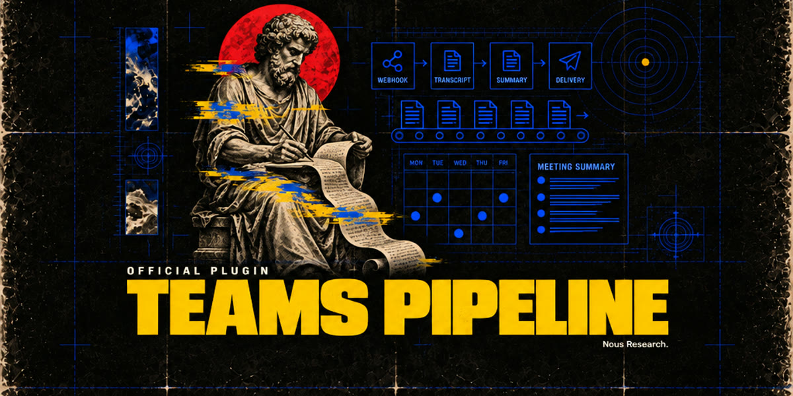

<p align="center"></p>

# Teams Meeting Pipeline for Hermes Agent

> Part of the [Hermes Official Plugins](../README.md), Nous Research's official plugins for Hermes Agent. Formerly bundled with Hermes core as `teams_pipeline`.

Turns Microsoft Teams meetings into summaries. Microsoft Graph change notifications arrive on the
`msgraph_webhook` gateway platform; each one becomes a durable job that resolves the meeting, fetches
its transcript (or the recording, transcribed with your STT provider when no transcript exists),
summarizes it and delivers the summary to Teams, Notion and/or Linear. The webhook acks Graph as soon
as the job is persisted; the work runs in the background, and duplicate notifications run a job once.

**Formerly built into Hermes core; existing users are migrated automatically.** `hermes update` (or
the first start after updating) installs and enables this plugin for every profile that had
`teams_pipeline` enabled. Config, credentials and the job store stay where they were.

## Install

```bash
hermes plugins install teams-pipeline
```

Then enable the `msgraph_webhook` platform in the gateway (it needs `extra.client_state`, and either a
loopback bind behind a tunnel/reverse proxy or `extra.allowed_source_cidrs`) and restart the gateway.

## Credentials

The pipeline reads meeting artifacts with an Entra app registration (client-credentials flow). Set
these in the profile's `.env`:

```bash
MSGRAPH_TENANT_ID=...
MSGRAPH_CLIENT_ID=...
MSGRAPH_CLIENT_SECRET=...
```

Teams delivery reuses the Teams platform's own settings (`delivery_mode`, `incoming_webhook_url`,
`team_id`/`channel_id` or `chat_id`, `access_token`, or the `TEAMS_*` env equivalents). Graph-mode
delivery without an `access_token` uses the app credentials above.

## Config

Pipeline settings live under the Teams platform in `config.yaml`:

```yaml
platforms:
  teams:
    extra:
      meeting_pipeline:
        transcript_min_chars: 80        # shorter transcripts fall back to the recording
        transcription_fallback: true
        stt_model: null                 # default STT model
        notion: {enabled: true, database_id: "..."}
        linear: {enabled: true, team_id: "..."}
        teams_delivery: {}              # overrides mirrored from platforms.teams.extra
```

The job store defaults to `teams_pipeline_store.json` in the profile's Hermes home
(`MSGRAPH_WEBHOOK_STORE_PATH` overrides it).

## Operator CLI

```bash
hermes teams-pipeline list                     # recent jobs
hermes teams-pipeline show <job_id>
hermes teams-pipeline run <job_id>             # replay a stored job
hermes teams-pipeline fetch ...                # dry-run artifact resolution for a meeting
hermes teams-pipeline subscribe ...            # create a Graph subscription
hermes teams-pipeline subscriptions            # list stored subscriptions
hermes teams-pipeline renew-subscription ...
hermes teams-pipeline delete-subscription <subscription_id>
hermes teams-pipeline maintain-subscriptions   # renew near-expiry subscriptions (cron-friendly)
hermes teams-pipeline token-health [--force-refresh]
hermes teams-pipeline validate                 # config snapshot check
```

`hermes teams-pipeline <command> --help` lists each command's options.

## Development

```bash
cd teams-pipeline
PYTHONPATH=/path/to/hermes-agent python -m pytest -q
```

## License

MIT
