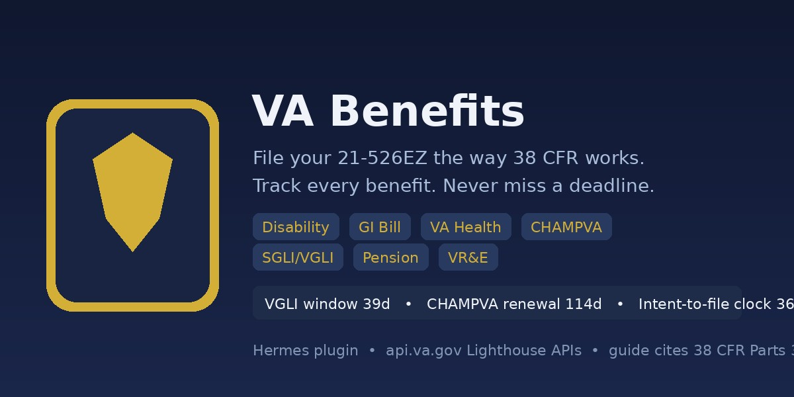

<p align="center"></p>

# VA Benefits for Hermes Agent

> Part of the [Hermes Official Plugins](../README.md), Nous Research's official plugins for Hermes Agent.

A full VA benefits tracker for Hermes Agent. Helps veterans file a disability
compensation claim (VA Form 21-526EZ) the way federal rules actually work, and
tracks every other VA benefit in one place: Post-9/11 GI Bill, VA health care
enrollment, CHAMPVA, SGLI/VGLI, pension, and VR&E.

Built by Bearden (Onyx Systems). The filing guidance is grounded in 38 CFR
Parts 3, 4, and 14 and 38 USC 5107/5901-5905, verified against eCFR text.

## What it does

Seven agent tools (toolset `va_claims`):

| Tool | Purpose |
|---|---|
| `va_claim_guide` | Filing playbook: intent-to-file rules, the service-connection triangle, the "at least as likely as not" standard, combined-ratings math, duty to assist, AMA appeal lanes, accreditation law, and a programs topic covering GI Bill, CHAMPVA, and VGLI deadlines |
| `va_intent_to_file` | Saves a local planning note only; never submits to VA, establishes an effective date, or starts a filing period |
| `va_claim_status` | Live claim status from the VA Lighthouse Benefits Claims API (sandbox or production) |
| `va_claim_track` | Snapshots claim status over time and reports what changed: phase moves, documents-needed flags, decision letters, date shifts |
| `va_disability_lookup` | Searches VA's official contention list so claims use names VA recognizes |
| `va_benefit_track` | Records any benefit program with status, detail, and expiration; expirations become tracked deadlines (the 120-day VGLI window, CHAMPVA renewals, GI Bill use-by dates) |
| `va_benefit_summary` | One-screen answer to "where am I with my VA benefits": every program, open claims, intents, and upcoming deadlines with days remaining |

Desktop app page (Settings → Plugins enables it): a **VA Benefits** page with a
benefits grid, claim phase trackers, deadline countdowns, and the full guide.

## Intent-to-file tracking is local only

`va_intent_to_file` does **not submit an intent or claim to VA**, with or without
production credentials. A successful response means only that a local plan was
saved. It records `recorded_on`, not a VA filing date, and creates no automatic
filing deadline. Submit separately through VA's official channels and confirm
VA receipt and the applicable deadline before relying on effective-date protection.

Earlier versions labeled local dates `filed_on` and generated an expiry. These
are not proof of VA receipt. Historical records remain on disk, but the summary
and desktop label them as local plans and suppress their automatically generated
filing deadlines. Other manually entered deadlines remain unchanged.

## Setup

Everything works with zero setup for the guide, intent-to-file, benefit
tracking, and deadlines. Live VA data needs free credentials:

1. **Claims API (sandbox):** apply at
   [developer.va.gov/explore/api/benefits-claims](https://developer.va.gov/explore/api/benefits-claims).
   Generate an RSA keypair (`openssl genrsa -out private.pem 2048`), send VA the
   public key as a JWK, and they email a client ID. Set plugin settings
   `client_id` and `private_key_path`. Sandbox test ICNs are on the VA test-users
   page. Production access requires VA agreements.
2. **Reference Data API:** free API key at
   [developer.va.gov/explore/api/benefits-reference-data](https://developer.va.gov/explore/api/benefits-reference-data).
   Set plugin setting `reference_api_key` (or env `VA_REFERENCE_API_KEY`).
3. Optional: `default_icn` so you never repeat the ICN, and `environment`
   (`sandbox` default).

## Disclosure (rule 13)

- Network calls: `api.va.gov` / `sandbox-api.va.gov` only (VA's official API
  platform). No third-party services, no telemetry.
- Data sent to VA: the veteran's ICN in a request header, plus the OAuth token
  exchange. Nothing else leaves the machine.
- Local writes: one JSON file per veteran under
  `~/.hermes/plugins-data/va-claims/` (claims, benefits, deadlines). No PII
  leaves that file except via the ICN call above.
- Credentials: VA client ID (config), your RSA private key path (config; the
  key file is yours, created by you), and the reference API key (declared
  secret, read through Hermes secret scope).
- Python dependency: `pyjwt[crypto]` (JWT signing for the VA token request).
- No hooks, no middleware, no shell commands, no background processes.

## Compliance note

Preparing, presenting, or prosecuting a VA claim for someone else for a fee
requires VA Office of General Counsel accreditation (38 USC 5902, 38 CFR Part
14). This plugin gives information and tracking, which needs no accreditation.
It never submits a claim or intent to file to VA, including with production credentials.

## Development

```
plugin.yaml            manifest (7 tools, config_schema, requires_hermes)
__init__.py            tools + VA API client (OAuth client-credentials grant)
guide.py               federal-standards guide text with CFR citations
schemas.py             tool schemas
store.py               local per-veteran benefits file
dashboard/plugin_api.py  FastAPI routes for the desktop page
desktop/plugin.js      Hermes Desktop page (routes + sidebar nav + chip)
```

## Running as a standalone MCP server

`mcp_server.py` exposes the same seven tools over MCP (stdio) for any MCP
client (Claude Desktop, Codex, other agents), no Hermes required. Handlers,
schemas and the local store are the plugin's own code; only the transport
differs. Needs Python 3.10+ and `mcp>=2`.

```json
{"mcpServers": {"va-claims": {"command": "python3", "args": ["/path/to/mcp_server.py"]}}}
```

Configuration via environment: `VA_CLAIMS_ICN`, `VA_CLAIMS_ENV`
(sandbox/production), `VA_REFERENCE_API_KEY`, `VA_CLAIMS_CLIENT_ID`,
`VA_CLAIMS_PRIVATE_KEY`. Tracker data lives under `$HERMES_HOME/plugins-data/
va-claims/` (default `~/.hermes`).
